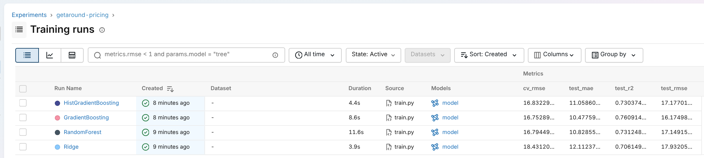

# GetAround Analysis — Jedha Bloc 5

[](https://github.com/clip93488-stack/getaround-analysis/actions/workflows/ci.yml)

Analyse du **délai minimum entre deux locations** et **modèle de pricing** pour GetAround,
le « Airbnb de la voiture ».

**Stack** — Python · Pandas · Scikit-learn · MLflow · Streamlit · FastAPI · Docker · Render

---

## Contexte

Deux problèmes distincts, deux livrables.

**1 · Les retards de restitution.** Les conducteurs rendent parfois la voiture en retard, ce qui
pénalise le conducteur suivant. GetAround envisage d'imposer un **délai minimum** entre deux
locations. Le Product Manager doit arbitrer deux paramètres : la durée du seuil (`threshold`)
et son périmètre (`scope` : toute la flotte, ou seulement les voitures Connect).

**2 · La fixation des prix.** Les propriétaires ont besoin d'une estimation du prix journalier
de location, servie par une API et utilisable depuis une interface web.

## Livrables

| Livrable | URL |
|---|---|
| Dashboard Streamlit (analyse des retards + estimation de prix) | `https://getaround-dashboard-z675.onrender.com` |
| API FastAPI `/predict` | `https://getaround-api-ztfm.onrender.com/predict` |
| Documentation de l'API (page `/docs`) | `https://getaround-api-ztfm.onrender.com/docs` |
| Swagger UI interactif | `https://getaround-api-ztfm.onrender.com/swagger` |

> Render a suffixé les noms des deux services (`-ztfm`, `-z675`) : ce sont les URL réellement
> attribuées. Après un nouveau déploiement depuis zéro, elles seraient à reporter ici
> (cf. [Déploiement](#déploiement)).

### Comment les pièces s'articulent

- `api/train.py` compare quatre modèles, trace chaque essai dans **MLflow** et produit le modèle
  servi (`model.pkl`, `feature_info.pkl`) ainsi que les choix du formulaire du dashboard
  (`dashboard/data/pricing_choices.json`).
- L'**API** (FastAPI, image Docker) charge le modèle et l'expose sur `POST /predict`.
- Le **dashboard** a deux vues, choisies dans la barre latérale : l'analyse du délai minimum
  (pour le Product Manager) et l'**estimation de prix**, un formulaire qui appelle l'API.
  Le dashboard ne charge jamais le modèle : il utilise l'API comme n'importe quel autre client.

---

## Résultats

### Analyse du délai minimum

Une location est **problématique** quand le conducteur *précédent* rend la voiture après l'heure
de début prévue de la location suivante. Sur 21 310 locations, 1 841 ont une location précédente
à moins de 12 h, dont 1 729 avec un retard précédent mesuré : **218 cas problématiques (12,6 %)**.

**Recommandation : seuil de 120 minutes sur l'ensemble de la flotte.**

| Indicateur | Valeur |
|---|---|
| Cas problématiques résolus | **180 / 218 — 82,6 %** |
| Locations bloquées | 666 — **3,1 % du volume total** |
| Rendement | 0,27 cas résolu par location bloquée |

Trois constats structurent cette recommandation :

- **La courbe de bénéfice sature vers 2 h.** Passer de 60 à 120 min gagne 15,6 points de cas
  résolus pour 1,2 point de locations bloquées ; passer de 120 à 180 min n'en gagne plus que 7,3
  pour 1,0 point. Au-delà, on n'ajoute pratiquement plus que du coût.
- **Le périmètre `connect` plafonne à 32 % de cas résolus**, quel que soit le seuil. Le flux
  `mobile` concentre 80 % du volume et affiche un taux de cas problématiques 1,8× supérieur
  (15,9 % contre 8,7 %) : l'exclure revient à ignorer l'essentiel du problème.
- **Le retard se paie en annulations** — 17,0 % des locations dont le conducteur précédent était
  en retard sont annulées, contre 11,2 % sinon, soit **+52 % en relatif**.

### Modèle de pricing

`GradientBoostingRegressor` retenu parmi quatre candidats — **R² test 0,761, MAE 10,48 €/jour**
sur un prix moyen de 121 €.

| Modèle | CV-RMSE | RMSE test | MAE test | R² test |
|---|---|---|---|---|
| **GradientBoosting** | **16,75** | **16,17** | **10,48** | **0,761** |
| RandomForest | 16,79 | 17,15 | 10,83 | 0,731 |
| HistGradientBoosting | 16,83 | 17,18 | 11,06 | 0,730 |
| Ridge *(référence)* | 18,43 | 17,93 | 12,11 | 0,706 |

Le modèle est choisi sur la RMSE de validation croisée 5-fold du jeu d'entraînement : le jeu de
test n'intervient pas dans la sélection. Le modèle servi est ensuite réentraîné sur toutes les
données.

---

## Structure du dépôt

```
getaround/
├── notebooks/
│   └── eda_delay.ipynb       Analyse exploratoire + simulation seuil × périmètre
├── dashboard/
│   ├── app.py                Dashboard Streamlit (vue « Délai minimum »)
│   ├── price_estimator.py    Vue « Estimation de prix » : formulaire + client de l'API
│   ├── data/                 Dataset des retards + pricing_choices.json (formulaire)
│   ├── requirements.txt
│   └── README.md
├── api/
│   ├── api.py                Application FastAPI
│   ├── train.py              Entraînement + suivi MLflow
│   ├── model.pkl             Pipeline sérialisé (versionné)
│   ├── feature_info.pkl      Contrat d'entrée (versionné)
│   ├── Dockerfile
│   ├── .dockerignore
│   ├── requirements.txt      Runtime de l'API (= versions d'entraînement)
│   ├── requirements-train.txt
│   └── README.md
├── tests/                    Tests pytest (API, client HTTP et vue du dashboard)
├── docs/
│   └── mlflow_runs.png       Suivi des expériences dans MLflow
├── data/
│   ├── projet_getaround_2.xlsx      Dataset retards
│   ├── projet_getarond_3.csv        Dataset pricing
│   ├── threshold_simulation.csv     Export de la simulation
│   └── model_leaderboard.csv        Comparaison des modèles
├── .github/workflows/ci.yml  Intégration continue : flake8, black, isort, pytest
├── .flake8, pyproject.toml   Configuration des outils de qualité (PEP 8, 79 colonnes)
├── requirements-dev.txt      Dépendances de développement
├── render.yaml               Blueprint Render : les deux services web
└── README.md
```

---

## Installation

Python **3.11 ou plus** est requis (`scikit-learn 1.9` et `numpy 2.4`) ; l'image Docker et
Render utilisent Python 3.12.

```bash
python -m venv .venv
source .venv/bin/activate              # Windows : .venv\Scripts\activate
pip install -r requirements-dev.txt    # API + dashboard + tests + qualité du code
pip install -r api/requirements-train.txt   # en plus : MLflow, pour réentraîner
```

## Utilisation

### Notebook d'analyse

```bash
jupyter lab notebooks/eda_delay.ipynb
```

### Entraînement du modèle et suivi MLflow

```bash
python api/train.py
mlflow ui --backend-store-uri sqlite:///mlflow.db      # http://localhost:5000
```

Le script entraîne les quatre modèles, enregistre pour chacun ses paramètres, ses métriques
(`cv_rmse`, `test_rmse`, `test_mae`, `test_r2`…) et le pipeline complet avec un exemple d'entrée
dans MLflow, puis écrit les artefacts utilisés par l'API et par le dashboard.



Les graines aléatoires sont fixées : deux exécutions donnent les mêmes métriques et les mêmes
prédictions. `mlflow.db` et `mlruns/` ne sont pas versionnés ; la commande ci-dessus les recrée.

### API

```bash
cd api && uvicorn api:app --reload --port 8000
```

Puis, sur `http://localhost:8000` : `/docs` (documentation rédigée), `/swagger` (Swagger UI),
`/health`, `/model-info` et `POST /predict` :

```bash
curl -X POST http://localhost:8000/predict \
     -H "Content-Type: application/json" \
     -d '{"input": [["Citroën", 140411, 100, "diesel", "black", "convertible", true, true, false, false, true, true, true]]}'
```

Réponse : `{"prediction":[111.88]}`

### Dashboard

```bash
cd dashboard && streamlit run app.py
```

La barre latérale propose deux vues : **Délai minimum entre locations** (par défaut) et
**Estimation de prix**. Cette seconde vue envoie le formulaire à l'API (`POST /predict`) et
affiche le prix journalier estimé, l'erreur moyenne du modèle et l'échange avec l'API.

Par défaut, le dashboard interroge l'API publique. Pour utiliser une API locale :

```bash
API_URL=http://localhost:8000 streamlit run app.py          # Windows PowerShell :
# $env:API_URL = "http://localhost:8000"; streamlit run app.py
```

### Docker

```bash
docker build -t getaround-api ./api
docker run -p 8000:8000 getaround-api
curl http://localhost:8000/health
```

Le conteneur lit la variable d'environnement `PORT` et retombe sur `8000` si elle est absente :
`docker run -e PORT=10000 -p 10000:10000 getaround-api` sert la même image sur un autre port.
L'image embarque uniquement `api.py`, `model.pkl` et `feature_info.pkl`.

---

## Qualité du code et tests

```bash
flake8                          # PEP 8, 79 colonnes : 0 erreur
black --check . && isort --check .
pytest                          # 42 tests
```

| Fichier de tests | Ce qu'il vérifie |
|---|---|
| `tests/test_api.py` | contrat de `/predict` (format positionnel et nommé, lot), erreurs 422, marque écrite avec ou sans accent, page `/docs` (un `h1`, tous les endpoints, exemples valides) |
| `tests/test_price_estimator.py` | client HTTP du dashboard (nouvelles tentatives, délai dépassé, erreurs), cohérence du formulaire avec le modèle servi, parcours complet de la vue « Estimation de prix » face à l'API réelle |

Les tests utilisent le vrai modèle : aucune réponse n'est simulée côté API. La même chaîne
(flake8, black, isort, pytest) tourne à chaque `push` via GitHub Actions
(`.github/workflows/ci.yml`).

---

## Déploiement

Les deux services sont décrits dans **`render.yaml`** à la racine du dépôt : Render lit ce
*Blueprint* et crée les deux services web en une fois, sans configuration manuelle.

| Service | Type Render | `rootDir` | Démarrage |
|---|---|---|---|
| `getaround-dashboard` | runtime `python` | `dashboard` | `streamlit run app.py --server.port $PORT …` |
| `getaround-api` | runtime `docker` | `api` | `Dockerfile` → `uvicorn --port ${PORT:-8000}` |

Les deux tournent sur le plan **`free`**.

### Étape 0 — Prérequis

1. Pousser le dépôt sur GitHub (cf. section suivante).
2. Créer un compte sur <https://render.com> et y connecter son compte GitHub.

Les artefacts versionnés (`model.pkl` 691 Ko, `projet_getaround_2.xlsx` 734 Ko) restent sous le
seuil de 100 Mo de GitHub : **git-lfs n'est pas nécessaire**.

### Étape 1 — Créer le Blueprint

1. <https://dashboard.render.com/blueprints> → **New Blueprint Instance**.
2. Sélectionner le dépôt GitHub. Render détecte `render.yaml` à la racine.
3. Vérifier que les deux services apparaissent, puis **Apply**.

Le dashboard se construit en 3–5 min, l'image Docker de l'API en 5–8 min. Les URL publiques sont
de la forme `https://<nom-du-service>.onrender.com`.

### Étape 2 — Le port

Render injecte la variable d'environnement **`PORT`** (10000 par défaut) et exige une écoute sur
`0.0.0.0`. Aucun port n'est codé en dur dans le dépôt :

- le dashboard reçoit `--server.port $PORT --server.address 0.0.0.0` dans son `startCommand` ;
- l'API démarre sur `${PORT:-8000}` — la valeur de repli `8000` préserve le comportement en local
  et sous `docker run` sans variable.

`healthCheckPath: /health` fait échouer le déploiement de l'API si le modèle ne se charge pas.

### Étape 3 — Vérifier le déploiement

```bash
curl https://getaround-api-ztfm.onrender.com/health
```

Réponse attendue : `{"status":"ok","model":"loaded","model_type":"GradientBoosting"}`

```bash
curl -X POST https://getaround-api-ztfm.onrender.com/predict \
     -H "Content-Type: application/json" \
     -d '{"input": [["Citroën", 140411, 100, "diesel", "black", "convertible", true, true, false, false, true, true, true]]}'
```

Réponse attendue : `{"prediction":[111.88]}`

Enfin, ouvrir `/docs` (documentation rédigée) et `/swagger` (Swagger UI), puis reporter les
URL obtenues dans le tableau [Livrables](#livrables) en tête de ce README.

Le dashboard appelle l'API à l'adresse publique ci-dessus. Si Render a attribué un autre nom au
service de l'API, définir la variable d'environnement `API_URL` du service `getaround-dashboard`
(Render → Environment) avec l'URL réelle de l'API.

> **Plan gratuit :** un service inactif depuis 15 min est mis en veille. La première requête
> qui le réveille peut prendre ~50 s — le premier `curl` après une pause n'est donc pas un échec.
> À l'ouverture de la vue « Estimation de prix », le dashboard réveille l'API en arrière-plan.

### Mettre à jour un service

Render redéploie automatiquement à chaque `git push` sur la branche suivie. Grâce à `rootDir`,
un changement dans `dashboard/` ne reconstruit pas l'image de l'API, et inversement.

---

## Notes de méthode

**Jointure sur la location précédente.** Le retard qui gêne le conducteur d'une location est celui
de la location *précédente*, récupéré via `previous_ended_rental_id` → `rental_id`. Comparer le
`delay_at_checkout_in_minutes` d'une ligne à son propre `time_delta_with_previous_rental_in_minutes`
confronterait deux grandeurs qui ne portent pas sur la même location.

**Valeurs manquantes.** Les 112 locations consécutives dont le retard précédent n'a pas été
enregistré sont *exclues* plutôt qu'imputées à zéro, ce qui sous-estimerait le problème.

**Encodage du CSV pricing.** Le fichier est en UTF-8. Le lire en latin-1 transformerait
silencieusement `Citroën` en mojibake — or cette marque représente 20 % des lignes, et deviendrait
une catégorie inconnue à l'inférence.

**Libellés catégoriels reçus par l'API.** Le même problème se pose côté client : un appel avec
`Citroen` (sans tréma) n'est pas une marque connue du `OneHotEncoder`, et la prédiction perdrait
l'effet de la marque (123,78 € au lieu de 111,88 € pour la même voiture). L'API ramène donc
chaque libellé à la modalité vue à l'entraînement, sans tenir compte de la casse ni des accents.
Une marque réellement inconnue n'est pas rejetée : elle est encodée à zéro.

**Formulaire du dashboard.** Les listes de marques, carburants, etc. du formulaire proviennent de
`dashboard/data/pricing_choices.json`, écrit par `train.py` à partir des données d'entraînement,
et non d'un appel à l'API au chargement de la page : l'hébergement gratuit met l'API en veille
(réveil de 30 à 60 s). Le calcul du prix, lui, passe toujours par l'API. Un test vérifie que ce
fichier reste cohérent avec le contrat de `/model-info`.

**Portée des résultats.** L'analyse du seuil repose sur 1 729 locations, soit 8 % du dataset.
Le modèle suppose qu'une location bloquée est une location *perdue* — hypothèse pessimiste,
puisqu'en pratique une partie des conducteurs décalerait simplement sa réservation. Un **A/B test**
sur un sous-ensemble de voitures validerait ces estimations avant généralisation.

---

*GetAround Analysis · Jedha Bootcamp Bloc 5 · Industrialisation ML*
